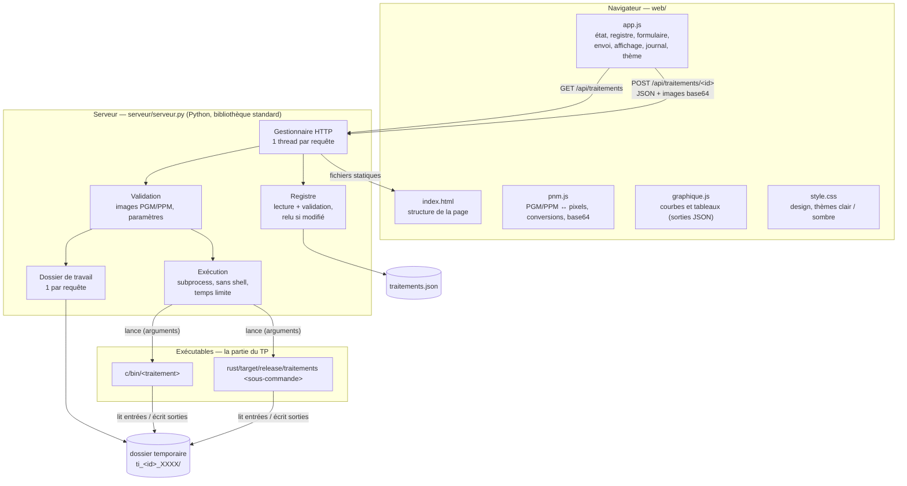
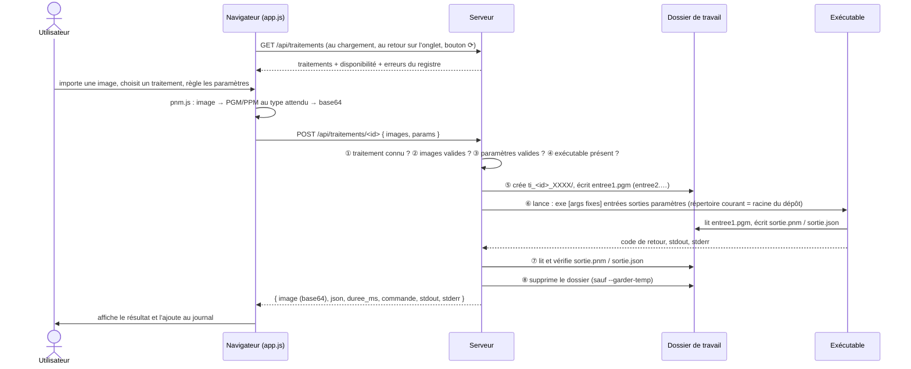

# Règles de développement

Ce document est pour **nous, les développeurs** : ce qu'un traitement doit respecter pour fonctionner
avec le serveur et l'interface, quel que soit le langage. Pour installer et lancer le projet, voir le [README](README.md).

## Sommaire

1. [Les règles essentielles](#les-règles-essentielles)
2. [Architecture complète](#architecture-complète) — composants, étapes d'une requête, **dossier de travail**, formats, limites
3. [Contrat d'un exécutable](#contrat-dun-exécutable)
4. [Le registre `traitements.json`](#le-registre-traitementsjson)
5. [Ajouter un traitement](#ajouter-un-traitement)
6. [Règles spécifiques au C](#règles-spécifiques-au-c)
7. [Règles spécifiques au Rust](#règles-spécifiques-au-rust)
8. [Windows](#windows)
9. [Git et travail en groupe](#git-et-travail-en-groupe)
10. [Interface web](#interface-web) — dont [ajouter un type de paramètre](#ajouter-un-type-de-paramètre)
11. [API HTTP du serveur](#api-http-du-serveur)

---

## Les règles essentielles

1. **Un traitement = un exécutable** (ou une sous-commande) qui lit des fichiers **PGM/PPM** et écrit un fichier PGM/PPM ou JSON. Rien d'autre : ni réseau, ni PNG, ni affichage.
2. **Ordre des arguments, toujours** : `entrées… sorties… paramètres…` ([détail](#ligne-de-commande)).
3. **Images 8 bits uniquement** : `P5` (gris) ou `P6` (couleur), valeur max **255**. Une image binaire est un PGM en **0 / 255**.
4. **Tout résultat est ramené dans [0, 255]** avant d'être écrit (gradient, laplacien, FFT, étiquettes…).
5. **Code de retour 0 = succès.** En cas d'échec : un **message clair sur stderr** (il s'affiche dans l'interface), et un code ≠ 0.
6. **Fichiers ouverts en binaire** (`"rb"` / `"wb"` en C), sinon les images sont corrompues sous Windows.
7. **Chaque traitement est déclaré dans `traitements.json`** : c'est la seule chose à modifier pour qu'il apparaisse dans l'interface.
8. **On ne versionne jamais d'exécutable compilé** (`c/bin/`, `rust/target/`) : chacun recompile chez soi.
9. **On teste son exécutable seul dans un terminal** avant de le brancher sur l'interface.
10. **Une branche par bloc, puis une pull request vers `main`.**

---

## Architecture complète

### Vue d'ensemble



| Composant | Fichiers | Fait | Ne fait jamais |
|---|---|---|---|
| **Interface** | `web/` | charge les images (PNG, JPEG, PGM…), les convertit au type attendu, construit menus et formulaires depuis le registre, envoie la demande, affiche image / courbes / erreurs | aucun calcul de traitement d'image |
| **Serveur** | `serveur/serveur.py` | sert l'interface, lit et valide le registre, valide images et paramètres, crée le dossier de travail, lance l'exécutable, vérifie et renvoie la sortie | aucun calcul de traitement d'image |
| **Registre** | `traitements.json` | décrit chaque traitement : commande, entrées, sortie, paramètres | — |
| **Exécutables** | `c/`, `rust/` | **tout le traitement d'image** : lire PGM/PPM, calculer, écrire PGM/PPM ou JSON | réseau, PNG/JPEG, affichage |

### Le serveur en détail

`serveur/serveur.py` est découpé en blocs indépendants :

| Bloc | Rôle |
|---|---|
| `Registre` | lit `traitements.json`, valide chaque entrée (une entrée invalide est écartée et signalée), le **relit automatiquement** quand sa date de modification change ; indique pour chaque traitement si son exécutable existe (`disponible`) |
| `lire_entete_pnm`, `verifier_type_entree` | vérifient qu'une image est un `P5`/`P6` 8 bits complet, et qu'elle correspond au type attendu (`gris`, `couleur`, `binaire`, `tous`) |
| `convertir_param` | vérifie une valeur de paramètre (type, bornes, options, taille) et la transforme en **texte** pour la ligne de commande |
| `resoudre_executable` | trouve l'exécutable : chemin relatif à la racine du dépôt, ajout automatique de `.exe` sous Windows, ou recherche dans le `PATH` |
| `dossier_de_travail` | crée puis supprime le dossier de travail d'une requête (voir plus bas) |
| `executer` | enchaîne toutes les étapes d'une requête (voir plus bas) |
| `Gestionnaire` | serveur HTTP : routes de l'API et fichiers statiques de `web/` ; une erreur imprévue devient une réponse `500` sans arrêter le serveur |

`ThreadingHTTPServer` traite **chaque requête dans son propre thread** : plusieurs traitements peuvent tourner en même temps, chacun dans son dossier.

### Étapes d'une requête



| Étape | Vérification | En cas d'échec |
|---|---|---|
| ① | le traitement existe dans le registre | `404` |
| ② | nombre d'images, base64 valide, `P5`/`P6` 8 bits complet, bon type d'entrée | `400` |
| ③ | paramètres connus, du bon type, dans les bornes ; les absents prennent leur valeur par défaut | `400` |
| ④ | l'exécutable existe | `503` |
| ⑥ | le programme se termine avant le temps limite, avec le code 0 | `504` / `500` (avec stderr) |
| ⑦ | la sortie existe et est une image PGM/PPM ou un JSON valide | `500` |

### Le dossier de travail (fichiers temporaires)

C'est là que le serveur et l'exécutable **échangent les fichiers**. Il est créé au début de **chaque requête** (étape ⑤) et supprimé à la fin (étape ⑧), **même en cas d'erreur**.

**Où ?**

| Système | Emplacement par défaut (dossier temporaire du système) |
|---|---|
| Linux | `/tmp/ti_<id>_XXXXXXXX/` |
| macOS | `/var/folders/…/T/ti_<id>_XXXXXXXX/` |
| Windows | `C:\Users\<nom>\AppData\Local\Temp\ti_<id>_XXXXXXXX\` |

`<id>` est l'identifiant du traitement et `XXXXXXXX` un suffixe aléatoire : deux requêtes simultanées ont toujours deux dossiers différents. Le serveur affiche au démarrage le dossier utilisé (ligne `fichiers :`).

**Contenu pendant l'exécution :**

```
ti_egalisation_k3j9x2a1/
├── entree1.pgm     écrit par le serveur  (entree1.ppm si l'image est en couleur)
├── entree2.pgm     écrit par le serveur  (seulement pour un traitement à 2 entrées)
├── sortie.pnm      écrit par l'exécutable (sorties « image » et « image+json »)
└── sortie.json     écrit par l'exécutable (sorties « json » et « image+json »)
```

| Fichier | Écrit par | Lu par | Format |
|---|---|---|---|
| `entree1.pgm` / `entree1.ppm` | serveur | exécutable | `P5` ou `P6`, 8 bits, exactement l'image envoyée par l'interface |
| `entree2.…` | serveur | exécutable | idem |
| `sortie.pnm` | exécutable | serveur | `P5` ou `P6`, 8 bits (l'extension `.pnm` ne dit pas lequel : c'est l'en-tête qui compte) |
| `sortie.json` | exécutable | serveur | JSON UTF-8 |

**Règles pour l'exécutable :**

- utiliser **exactement les chemins reçus en arguments** : ils sont **absolus**, ne jamais les reconstruire ni supposer un nom de fichier ;
- ne rien écrire d'autre dans ce dossier, et rien ailleurs ;
- ne pas compter sur le dossier courant : c'est la **racine du dépôt**, pas le dossier de travail.

**Chemins sous Linux et Windows :** le serveur passe les chemins sous forme de **liste d'arguments** (pas de shell). Un chemin contenant des espaces ou des accents (`C:\Users\Jean Dupont\…`, `/home/élodie/…`) arrive donc **intact** dans `argv`, sans guillemets à gérer. Rust le reçoit en UTF-8 sur tous les systèmes. Un programme C sous Windows reçoit `argv` dans l'encodage local : si le nom d'utilisateur contient des caractères hors de cet encodage (alphabet non latin), `fopen` peut échouer ; dans ce cas, lancer le serveur avec `--dossier-temp C:\ti` (ou tout chemin simple).

**Options du serveur pour déboguer :**

| Option | Effet |
|---|---|
| `--dossier-temp DOSSIER` | crée les dossiers de travail sous `DOSSIER` au lieu du dossier temporaire du système |
| `--garder-temp` | ne supprime pas les dossiers de travail ; leur chemin est affiché dans le terminal du serveur |

Exemple : voir exactement ce que reçoit et produit un traitement, puis le relancer à la main.

```bash
python3 serveur/serveur.py --dossier-temp temp --garder-temp     # le dossier temp/ est ignoré par Git
# … lancer le traitement depuis l'interface, puis :
ls temp/ti_egalisation_*/                                         # entree1.pgm  sortie.pnm
rust/target/release/traitements egalisation temp/ti_egalisation_*/entree1.pgm /tmp/essai.pgm locale 7
```

Le journal de l'interface affiche aussi la commande exécutée, avec les noms de fichiers (`traitements egalisation entree1.pgm sortie.pnm locale 7`).

### Formats à chaque étape

| Passage | Image | Paramètres | Résultat |
|---|---|---|---|
| Fichier choisi → interface | PNG, JPEG, WebP, BMP, GIF, PGM, PPM, PBM | — | — |
| Interface (mémoire) | pixels 8 bits, 1 ou 3 canaux | valeurs JS (nombre, booléen, texte, tableau) | — |
| Interface → serveur | PGM `P5` / PPM `P6` encodé en **base64** dans du JSON | objet JSON `{ nom: valeur }` | — |
| Serveur → exécutable | **fichier** `P5` / `P6` dans le dossier de travail | **arguments texte** (`5`, `0.5`, `1`, `locale`, `1,2,1`) | — |
| Exécutable → serveur | — | — | **fichier** `P5`/`P6` et/ou JSON, code de retour, stdout, stderr |
| Serveur → interface | — | — | JSON : image en base64, JSON du traitement, durée, commande, stdout, stderr |

### Limites et valeurs par défaut

| Élément | Valeur | Où la changer |
|---|---|---|
| Adresse / port | `127.0.0.1:8000` | `--hote`, `--port` |
| Taille d'une requête | 64 Mo (images en base64) | `TAILLE_MAX_REQUETE` dans `serveur.py` |
| Dimensions d'une image | 10 000 × 10 000 px | `DIMENSION_MAX` (serveur) et `DIMENSION_MAX` (`app.js`) |
| Temps limite d'un traitement | 30 s | champ `timeout` du traitement dans le registre |
| stdout / stderr renvoyés | 10 000 derniers caractères | `TAILLE_MAX_STDERR` dans `serveur.py` |
| Journal de l'interface | 30 dernières exécutions | `journaliser` dans `app.js` |

### Sécurité

- Le serveur n'écoute qu'en **local** (`127.0.0.1`) : il n'est pas accessible depuis le réseau.
- Les programmes sont lancés **sans shell** : un paramètre ne peut pas injecter de commande.
- Les fichiers statiques sont servis uniquement depuis `web/` (les chemins `../` sont refusés).
- Chaque requête a son propre dossier : aucun mélange entre utilisateurs ou requêtes simultanées.

---

## Contrat d'un exécutable

### Ligne de commande

```
<programme> <entrée 1> [<entrée 2>] <sortie(s)> [<param 1> <param 2> ...]
```

1. **Les chemins des images d'entrée** (0, 1 ou 2 selon le traitement)
2. **Les chemins des sorties**, selon le type de sortie déclaré dans le registre :
   - `image` → un chemin : l'image résultat
   - `json` → un chemin : le fichier JSON résultat
   - `image+json` → deux chemins : l'image **puis** le JSON
3. **Les paramètres**, dans l'**ordre où ils sont déclarés dans le registre**, sous forme de texte

```bash
c/bin/median  entree1.pgm  sortie.pnm  5                         # 1 entrée, image, 1 paramètre
c/bin/addition  entree1.pgm  entree2.pgm  sortie.pnm             # 2 entrées
rust/target/release/traitements histogramme  entree1.ppm  sortie.json   # sortie JSON
c/bin/otsu  entree1.pgm  sortie.pnm  sortie.json                 # image + JSON
```

### Paramètres reçus

| Type déclaré | Argument reçu | Lecture en C | Lecture en Rust |
|---|---|---|---|
| `int` | `5` | `atoi(argv[i])` | `args[i].parse::<i32>()` |
| `float` | `0.5` | `atof(argv[i])` | `args[i].parse::<f64>()` |
| `bool` | `1` ou `0` | `atoi(argv[i]) != 0` | `args[i] == "1"` |
| `choix` | `sobel` | `strcmp(argv[i], "sobel") == 0` | `args[i].as_str()` |
| `liste` | `1,2,1,2,4,2,1,2,1` | `strtok` + `strtod` | `args[i].split(',')` |

Les valeurs sont **déjà validées par le serveur** (type, bornes, options, taille de liste). L'exécutable les vérifie quand même s'il est utilisé seul en ligne de commande.

### Images

```
P5                  P5 = gris (1 octet par pixel) ; P6 = couleur (3 octets : R, G, B)
<largeur> <hauteur>
255
<pixels, ligne par ligne, de haut en bas et de gauche à droite>
```

- **Entrées** : toujours `P5` ou `P6`, valeur max 255. L'en-tête peut contenir des commentaires `# ...`.
- **Sortie** : `P5` ou `P6` au choix de l'exécutable, valeur max **255** obligatoire. Le chemin de sortie se termine par `.pnm` : ne pas s'en servir pour choisir le format.
- **Images binaires** (seuillage, morphologie, étiquetage…) : PGM dont les pixels valent **0 (fond) ou 255 (objet)**. Un programme qui travaille en 0/1 convertit à la lecture et à l'écriture.
- **Valeurs hors de [0, 255]** : c'est à l'exécutable de les ramener dans [0, 255] (valeur absolue, normalisation min-max, `log(1+|F|)` pour un spectre, couleurs aléatoires pour des étiquettes…).
- Organisation des pixels en mémoire : le canal `c` du pixel `(x, y)` est à l'indice `(y × largeur + x) × canaux + c`, avec `x`, `y` et `c` qui commencent à 0 et l'origine en haut à gauche.

### Sortie JSON (histogramme, profil, statistiques…)

Tout ce qui n'est pas une image est renvoyé en JSON. L'interface sait afficher cette structure (les deux clés sont facultatives) :

```json
{
  "courbes": [
    { "nom": "Rouge", "couleur": "#e34948", "style": "barres", "x": [0, 1, 2], "valeurs": [12, 40, 33] }
  ],
  "valeurs": { "moyenne": 117.4, "écart-type": 52.1, "seuil": 125 }
}
```

- `courbes` : tracées en graphique. `x`, `couleur` et `style` sont facultatifs (`x` par défaut 0, 1, 2… ; `"style": "barres"` pour des barres au lieu d'une ligne). Toutes les courbes d'un résultat partagent le même axe : elles doivent être de la même grandeur.
- `valeurs` : affichées en tableau clé / valeur.
- Toute autre clé est visible dans « Données brutes (JSON) ».
- Le fichier doit être en **UTF-8**.

### Code de retour et messages

- **`0`** : succès, le serveur lit les sorties.
- **Autre valeur** : échec ; le contenu de **stderr** est affiché dans l'interface. Écrire un message compréhensible (`fprintf(stderr, ...)` / `eprintln!(...)`).
- **stdout** est affiché dans le journal de l'interface (pratique pour déboguer), mais n'est pas interprété.
- **Temps limite** : 30 s par défaut (champ `timeout` du registre). Au-delà, le processus est tué.

---

## Le registre `traitements.json`

Il décrit tous les traitements. Le serveur le **relit automatiquement** quand il change.

```json
{
  "traitements": [
    {
      "id": "median",
      "nom": "Filtre médian",
      "chapitre": "Filtrage spatial",
      "description": "Remplace chaque pixel par la médiane de son voisinage NxN.",
      "auteur": "Prénom",
      "langage": "C",
      "commande": ["c/bin/median"],
      "entrees": [{ "nom": "Image", "type": "gris" }],
      "sortie": "image",
      "params": [
        { "nom": "taille", "label": "Taille du voisinage", "type": "int", "min": 3, "max": 15, "pas": 2, "defaut": 3 }
      ],
      "timeout": 30
    }
  ]
}
```

### Champs d'un traitement

| Champ | Obligatoire | Description |
|---|---|---|
| `id` | **oui** | identifiant unique (lettres, chiffres, `-`, `_`) |
| `commande` | **oui** | liste : l'exécutable, puis d'éventuels arguments fixes placés **avant** les entrées. Un chemin contenant `/` est relatif à la racine du dépôt (**toujours avec `/`, sans `.exe`**, même sous Windows) ; sinon il est cherché dans le `PATH` |
| `nom` | non | nom affiché (défaut : `id`) |
| `chapitre` | non | regroupement dans l'interface (défaut : `Divers`) |
| `description` | non | texte d'aide affiché |
| `auteur`, `langage` | non | affichés dans l'interface |
| `entrees` | non | liste des images d'entrée (défaut : une image de type `tous`) ; peut être vide |
| `sortie` | non | `image` (défaut), `json` ou `image+json` |
| `params` | non | liste **ordonnée** des paramètres |
| `timeout` | non | temps limite en secondes (défaut : 30) |

Un exécutable avec des sous-commandes (c'est le cas du Rust) met la sous-commande dans `commande` :
`"commande": ["rust/target/release/traitements", "histogramme"]`.

### Types d'entrée

| `type` | Image reçue par l'exécutable |
|---|---|
| `gris` | PGM (`P5`) — l'interface convertit une image couleur |
| `couleur` | PPM (`P6`) — l'interface recopie une image grise dans R, G, B |
| `binaire` | PGM en 0 / 255 — l'interface refuse une image qui ne l'est pas |
| `tous` | PGM ou PPM, tel quel |

### Types de paramètres

| `type` | Champs spécifiques | Contrôle affiché | Exemple |
|---|---|---|---|
| `int` | `min`, `max`, `pas` | curseur + champ | `{"nom": "taille", "type": "int", "min": 3, "max": 15, "pas": 2, "defaut": 3}` |
| `float` | `min`, `max`, `pas` | curseur + champ | `{"nom": "gamma", "type": "float", "min": 0.1, "max": 5, "pas": 0.1, "defaut": 1.0}` |
| `bool` | | case à cocher | `{"nom": "inverser", "type": "bool", "defaut": false}` |
| `choix` | `options` (**obligatoire**) | boutons ou liste | `{"nom": "connexite", "type": "choix", "options": ["4", "8"], "defaut": "8"}` |
| `liste` | `taille` | **éditeur de matrice** si taille = 9, 25, 49… ; champ texte sinon | `{"nom": "noyau", "type": "liste", "taille": 9, "defaut": "1,1,1,1,1,1,1,1,1"}` |

Chaque paramètre a un `nom`, un `defaut` (**obligatoire**, et lui-même validé), un `label` facultatif (texte affiché au-dessus du contrôle) et une `aide` facultative (phrase d'explication affichée en dessous) :

```json
{ "nom": "fenetre", "label": "Fenêtre", "type": "int", "min": 3, "max": 31, "pas": 2, "defaut": 7,
  "aide": "Taille du voisinage carré utilisé en mode locale." }
```

Besoin d'un contrôle qui n'existe pas (texte libre, couleur, fichier…) ? Voir [ajouter un type de paramètre](#ajouter-un-type-de-paramètre).

Une entrée mal écrite (champ manquant, type inconnu, `id` en double…) est **ignorée** sans bloquer les autres, et l'erreur s'affiche en haut de l'interface.
Vérifier le fichier : `python3 -m json.tool traitements.json` (Windows : `py -m json.tool traitements.json`).

---

## Ajouter un traitement

1. **Écrire le code** dans `rust/` ou `c/` en respectant le [contrat](#contrat-dun-exécutable) et les règles de [C](#règles-spécifiques-au-c) ou de [Rust](#règles-spécifiques-au-rust).
2. **Compiler.**
3. **Tester seul** dans un terminal, sur une image de `images/` :
   ```bash
   rust/target/release/traitements egalisation images/exemple.pgm /tmp/resultat.pgm globale 7
   ```
   Ouvrir le résultat avec GIMP (ou tout lecteur qui accepte le PGM/PPM).
4. **Déclarer** le traitement dans `traitements.json` (ajouter l'entrée **à la fin** de la liste).
5. **Recharger l'interface** (bouton ⟳) : le traitement apparaît.
6. Mettre à jour le tableau « Répartition du travail » du README.

---

## Règles spécifiques au C

- **Ouvrir les fichiers en binaire, toujours** : `fopen(chemin, "rb")` et `fopen(chemin, "wb")`. En mode texte (`"r"`/`"w"`), Windows transforme chaque octet 10 en deux octets et l'image est détruite ; sous Linux l'erreur passe inaperçue.
- **Exécutables dans `c/bin/`**, un par traitement :
  ```bash
  gcc -O2 -Wall -o c/bin/median c/src/median.c c/src/pnm.c -lm
  ```
  Sous Windows (MSYS2 / MinGW), la même commande produit `c/bin/median.exe` : ne rien changer dans le registre, le serveur ajoute `.exe` tout seul.
- **Lecture/écriture PGM/PPM** : une seule implémentation partagée (`c/src/pnm.c` / `pnm.h`) pour tout le groupe, comme `pnm.rs` en Rust.
- **Messages sur stderr** : `fprintf(stderr, "...")`, puis `return 1;`. Éviter les accents dans les messages en C (l'encodage n'est pas garanti sous Windows).
- **Mémoire** : vérifier le retour de `malloc`, libérer avant de quitter.
- Compiler avec `-Wall` et corriger les avertissements.

## Règles spécifiques au Rust

- **Un seul projet** (`rust/`), **un seul exécutable** `traitements`, **une sous-commande par traitement**.
- **Ajouter un traitement** :
  1. créer `rust/src/mon_traitement.rs` avec `pub fn executer(args: &[String]) -> Resultat` ;
  2. dans `rust/src/main.rs` : ajouter `mod mon_traitement;` et une ligne dans le tableau `TRAITEMENTS` ;
  3. dans `traitements.json` : `"commande": ["rust/target/release/traitements", "mon-traitement"]`.
- **Lire et écrire les images uniquement avec `pnm::lire` et `pnm::ecrire`** (`rust/src/pnm.rs`).
- **Vérifier les arguments** avec `verifier_arguments(args, &["entrée", "sortie", ...])` (message d'erreur automatique).
- **Erreurs** : renvoyer `Err(...)` (avec `?` ou `.into()`) plutôt que `panic!` / `unwrap()` : `main` écrit le message sur stderr et renvoie le code 1.
- **Voisinage** : `x - 1` sur un `usize` plante quand `x = 0`. Utiliser `x.saturating_sub(r)` et `.min(largeur - 1)`, ou calculer en `i64` puis vérifier les bornes.
- **Aucune dépendance externe** (bibliothèque standard uniquement).
- **Tests** : un module `#[cfg(test)]` par fichier, avec au moins un petit exemple calculé à la main. Avant chaque commit :
  ```bash
  cd rust && cargo test && cargo build --release
  ```
  et aucun avertissement de compilation.

---

## Windows

L'application fonctionne sous Windows ; les points à connaître :

| Sujet | Règle |
|---|---|
| Lancer le serveur | `py serveur\serveur.py` (au lieu de `python3`) |
| Exécutables | le serveur trouve `traitements.exe` / `median.exe` à partir de `rust/target/release/traitements` / `c/bin/median` : **ne jamais écrire `.exe` ni `\` dans `traitements.json`** |
| Fichiers en C | toujours `"rb"` / `"wb"` (voir [règles C](#règles-spécifiques-au-c)) |
| Fins de ligne | gérées par `.gitattributes` : le code est en LF, les images ne sont jamais modifiées par Git |
| Messages d'erreur | en UTF-8 (automatique en Rust) ; en C, éviter les accents |
| Rust | rustup demande les « Build Tools » de Visual Studio : les installer |
| Dossier de travail | `C:\Users\<nom>\AppData\Local\Temp\ti_…` ; les espaces et accents du chemin ne posent pas de problème. Si un programme C n'arrive pas à ouvrir ses fichiers (nom d'utilisateur en alphabet non latin) : `--dossier-temp C:\ti` ([détails](#le-dossier-de-travail-fichiers-temporaires)) |

---

## Git et travail en groupe

1. **Une branche par bloc** : `git switch -c contours` (jamais de travail directement sur `main`).
2. Commits petits et clairs ; `git push` sur sa branche.
3. **Pull request vers `main`** ; un autre membre relit avant la fusion.
4. **`traitements.json`** est modifié par tout le monde : ajouter ses entrées **à la fin**, vérifier que le JSON est valide, et bien relire les conflits.
5. **Ne jamais commiter** : exécutables (`c/bin/`, `rust/target/`), images de résultats, fichiers personnels. Le `.gitignore` s'en charge en grande partie.
6. **`.gitattributes`** déclare les images comme binaires et impose LF pour le code : ne pas le modifier sans en parler.
7. Les images de test partagées vont dans `images/` (petites, en PGM/PPM ou PNG).

---

## Interface web

Uniquement HTML, CSS et JavaScript, sans framework ni dépendance. On ne la modifie que si on en a vraiment besoin : **un nouveau traitement ne demande aucun changement de l'interface**.

| Fichier | Rôle |
|---|---|
| `web/index.html` | structure de la page |
| `web/style.css` | design system ; **toutes les couleurs sont des variables CSS** en tête de fichier (une série pour le clair, une pour le sombre) |
| `web/app.js` | registre, formulaire des paramètres, envoi au serveur, affichage, journal, thème |
| `web/pnm.js` | lecture / écriture PGM-PPM côté navigateur, conversions, base64 |
| `web/graphique.js` | affichage des sorties JSON (courbes, tableau de valeurs) |

Conventions :

- **Jamais de couleur écrite en dur** : utiliser ou ajouter une variable dans les deux thèmes.
- **Pas de commande ni d'adresse** dans les messages de l'interface : renvoyer au README.
- Conversion couleur → gris faite par l'interface : luminance UIT-R BT.601, `Y = 0,299 R + 0,587 G + 0,114 B` ; la transparence est posée sur fond blanc.
- Tester les deux thèmes (bouton lune/soleil) et une fenêtre étroite (mobile) après une modification.

### Ajouter un type de paramètre

Le formulaire est **entièrement généré** à partir du registre. Si un traitement a besoin d'un élément de formulaire particulier :

1. **D'abord, vérifier qu'un type existant ne suffit pas** : `int`/`float` (curseur + champ), `bool` (case), `choix` (boutons ou liste), `liste` (matrice ou nombres), complétés par `label` et `aide`. C'est le cas pour presque tout le cours.
2. **Ne jamais ajouter d'élément à la main dans `index.html` ni de code spécifique à un traitement** : l'élément doit marcher pour n'importe quel traitement qui déclare ce type.
3. Sinon, un nouveau type se déclare à **deux endroits**, plus la documentation :

**① Serveur (`serveur/serveur.py`)** : accepter le type et le convertir en **texte** pour la ligne de commande.

```python
TYPES_PARAM = ("int", "float", "bool", "choix", "liste", "texte")   # ajouter le type

# dans convertir_param(), avant la dernière ligne :
    if type_ == "texte":
        if not isinstance(valeur, str):
            raise ErreurClient(400, f"parametre '{nom}' : texte attendu")
        if len(valeur) > param.get("longueur_max", 200):
            raise ErreurClient(400, f"parametre '{nom}' : texte trop long")
        return valeur, valeur          # (valeur conservée, argument passé au programme)
```

**② Interface (`web/app.js`)** : écrire une **fabrique** et l'ajouter au tableau `CONTROLES`.

```js
const CONTROLES = {
  // … types existants …
  texte: controleTexte,
};

/** texte : champ de saisie libre. */
function controleTexte(p, valeur, maj, id) {
  const champ = document.createElement("input");
  champ.type = "text";
  champ.id = id;                        // relie le champ à son <label>
  champ.className = "champ champ-large"; // styles existants (thèmes clair et sombre)
  champ.value = valeur;
  champ.maxLength = p.longueur_max ?? 200;
  champ.addEventListener("input", () => maj(champ.value)); // à appeler à chaque modification
  return { elements: [champ] };         // + aide: { texte } ou sansEtiquette: true si besoin
}
```

Une fabrique reçoit le paramètre `p` tel qu'écrit dans le registre, sa valeur courante, la fonction `maj` et l'`id` du champ ; elle renvoie les éléments à insérer. L'étiquette (`label`), le texte d'`aide`, l'enregistrement de la valeur, la remise aux valeurs par défaut et l'envoi au serveur sont gérés automatiquement.

**③ Documentation** : ajouter le type au tableau [Types de paramètres](#types-de-paramètres) avec un exemple.

Règles : réutiliser les classes CSS existantes (`champ`, `champ-nombre`, `champ-large`, `options`, `matrice`…) ; si un style nouveau est nécessaire, l'écrire dans `style.css` **avec les variables de couleur** ; tester dans les deux thèmes.

---

## API HTTP du serveur

Utile seulement pour modifier l'interface ou le serveur.

### `GET /api/traitements`

```json
{
  "traitements": [
    { "id": "median", "nom": "Filtre médian", "chapitre": "Filtrage spatial", "description": "...",
      "auteur": "...", "langage": "C", "entrees": [{ "nom": "Image", "type": "gris" }], "sortie": "image",
      "params": [...], "timeout": 30, "disponible": true, "raison": "" }
  ],
  "erreurs_registre": []
}
```

`disponible: false` (avec `raison`) quand l'exécutable n'est pas compilé.

### `POST /api/traitements/<id>`

Requête :

```json
{ "images": ["<PGM ou PPM en base64>"], "params": { "taille": 5 } }
```

Réponse (HTTP 200) :

```json
{
  "traitement": "median", "duree_ms": 12.4, "params": { "taille": 5 },
  "commande": "median entree1.pgm sortie.pnm 5", "stdout": "", "stderr": "",
  "image": { "format": "pgm", "largeur": 512, "hauteur": 512, "donnees": "<base64>" },
  "json": { "valeurs": { "seuil": 125 } }
}
```

`image` est présent pour les sorties `image` et `image+json`, `json` pour `json` et `image+json`.

### Erreurs

Toujours de la forme `{ "erreur": "message court", "details": "stderr ou explication (peut être null)" }`.

| Code | Cause |
|---|---|
| `400` | requête invalide : image absente ou mal formée, mauvais type d'image, paramètre hors bornes ou inconnu… |
| `404` | traitement ou route inconnu |
| `413` | requête de plus de 64 Mo |
| `500` | l'exécutable a échoué (code ≠ 0, sortie absente ou invalide) — `details` contient son stderr |
| `503` | exécutable introuvable (pas compilé) |
| `504` | temps limite dépassé |

Le serveur ne plante jamais à cause d'une requête : une erreur inattendue renvoie un `500` et la trace s'affiche dans son terminal.
