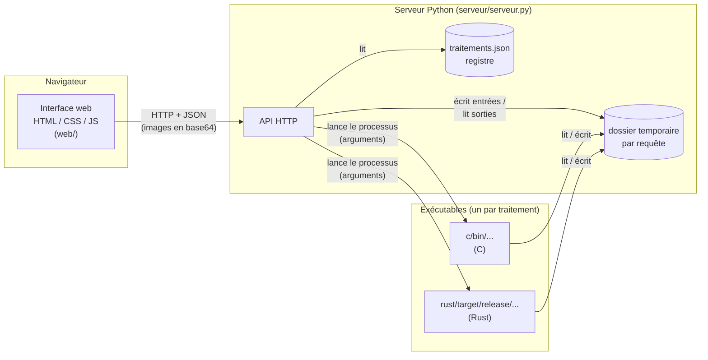
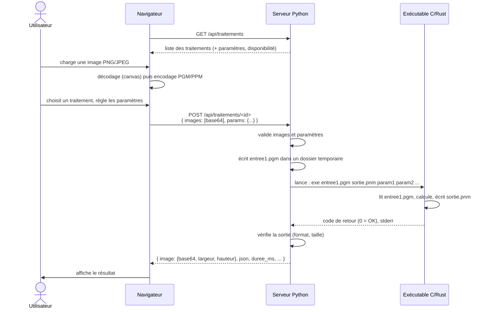

# Traitement d'image

Implémentation des opérations de traitement d'image vues en cours (M2 SIG), en **C** ou en **Rust**,
avec une **interface web** commune pour charger une image, choisir un traitement et voir le résultat.

La liste complète des traitements à implémenter est dans [`liste-fonctionnalites.txt`](liste-fonctionnalites.txt).

---

## Sommaire

1. [Démarrage rapide](#1-démarrage-rapide)
2. [Architecture](#2-architecture)
3. [Communication entre les composants](#3-communication-entre-les-composants)
4. [Contrat d'un exécutable (C ou Rust)](#4-contrat-dun-exécutable-c-ou-rust)
5. [Le registre `traitements.json`](#5-le-registre-traitementsjson)
6. [API HTTP du serveur](#6-api-http-du-serveur)
7. [Gestion des erreurs](#7-gestion-des-erreurs)
8. [Ajouter un traitement : la marche à suivre](#8-ajouter-un-traitement--la-marche-à-suivre)
9. [Organisation du dépôt et travail en groupe](#9-organisation-du-dépôt-et-travail-en-groupe)

---

## 1. Démarrage rapide

Prérequis : **Python 3.8+** (aucune bibliothèque à installer), un compilateur C (`gcc`) et/ou Rust (`cargo`).

```bash
# depuis la racine du dépôt
python3 serveur/serveur.py
```

Puis ouvrir **http://127.0.0.1:8000/** dans le navigateur.

Options du serveur :

| Option | Défaut | Rôle |
|---|---|---|
| `--port` | `8000` | port d'écoute |
| `--hote` | `127.0.0.1` | adresse d'écoute (local uniquement par défaut) |
| `--registre` | `traitements.json` | fichier décrivant les traitements |
| `-v` | | journal détaillé (chaque requête HTTP) |

---

## 2. Architecture

Le système est découpé en **trois composants indépendants** :



| Composant | Rôle | Ce qu'il **ne fait pas** |
|---|---|---|
| **Interface web** (`web/`) | Charger une image (PNG, JPEG…), la convertir en PGM/PPM, afficher la liste des traitements et leurs paramètres, afficher le résultat (image, courbe, valeurs) | Aucun calcul de traitement d'image |
| **Serveur** (`serveur/serveur.py`) | Servir l'interface, lire le registre, valider les images et les paramètres, lancer l'exécutable, renvoyer le résultat, gérer les erreurs et le temps limite | Aucun calcul de traitement d'image |
| **Exécutables** (`c/`, `rust/`) | **Tout le traitement d'image** : lire une image PGM/PPM, appliquer l'opération, écrire le résultat | Aucune gestion de réseau, de PNG/JPEG ou d'affichage |

### Principes de conception

- **Indépendance du langage** : le serveur ne connaît que des exécutables. Un traitement écrit en C et un traitement écrit en Rust sont lancés exactement de la même façon.
- **Un format d'image unique** : PGM binaire (`P5`) et PPM binaire (`P6`), 8 bits. C'est le format conseillé par le cours ; il se lit et s'écrit en quelques lignes, sans bibliothèque. Les conversions PNG/JPEG ↔ PGM/PPM sont faites par le navigateur.
- **Le registre est la seule chose à modifier** pour brancher un nouveau traitement : l'interface construit ses menus et ses formulaires à partir de lui. Personne n'a besoin de toucher au code du serveur ou de l'interface.
- **Chaque exécutable est testable seul** dans un terminal, sans serveur ni navigateur.
- **Isolation** : chaque requête travaille dans son propre dossier temporaire, supprimé à la fin. Plusieurs requêtes peuvent s'exécuter en parallèle.

### L'interface web (`web/`)

HTML, CSS et JavaScript simples, sans framework ni dépendance (seules les polices Geist / JetBrains Mono sont chargées depuis Google Fonts, avec repli sur les polices système hors connexion). Design repris de la maquette Stitch « Precision Utility ».

| Fichier | Rôle |
|---|---|
| `index.html` | structure de la page |
| `style.css` | design system (couleurs, typographie, composants) |
| `app.js` | logique : registre, formulaire des paramètres, envoi au serveur, affichage, journal |
| `pnm.js` | lecture / écriture PGM-PPM, conversions, base64 |
| `graphique.js` | affichage des sorties JSON (courbes avec infobulle, tableau de valeurs) |

Fonctionnalités :

- **Menus générés depuis le registre** : chapitres, recherche, nombre d'entrées, type de sortie, langage. Un traitement non compilé est marqué « non compilé » et ne peut pas être lancé. Le registre est relu quand on revient sur l'onglet (ou avec le bouton ⟳).
- **Formulaire des paramètres généré automatiquement** : curseur + champ pour `int`/`float` bornés, case à cocher pour `bool`, boutons ou liste déroulante pour `choix`, **éditeur de matrice** pour une `liste` de taille 9, 25, 49… (noyaux de convolution), champ texte sinon. Les bornes sont vérifiées avant l'envoi.
- **Import d'images** : bouton ou glisser-déposer ; PNG, JPEG, WebP, BMP, GIF et aussi PGM/PPM/PBM (ASCII ou binaire, que le navigateur ne sait pas afficher seul).
- **Conversion automatique selon le type d'entrée attendu** :
  - `gris` : une image couleur est convertie avec la luminance UIT-R BT.601 (Y = 0,299 R + 0,587 G + 0,114 B) ;
  - `couleur` : une image grise est recopiée dans R, G et B ;
  - `binaire` : aucune conversion, l'interface refuse une image qui n'est pas en 0/255 et invite à faire un seuillage d'abord ;
  - la transparence (PNG) est posée sur fond blanc.
  Le badge de chaque image indique la conversion qui sera faite (ex. « RGB → convertie en gris »).
- **Affichage du résultat** : image (agrandie sans flou si elle est petite), courbes et valeurs pour les sorties JSON, message d'erreur avec le `stderr` du programme en cas d'échec.
- **Enchaînement** : boutons « Entrée A » / « Entrée B » pour réutiliser le résultat (ex. seuillage → érosion → étiquetage).
- **Téléchargement** du résultat en PNG ou en PGM/PPM.
- **Inspecteur de pixels** : coordonnées et valeur du pixel survolé sous chaque image.
- **Journal** : commande exécutée, durée, `stdout`, `stderr` et erreurs des 30 dernières exécutions.
- Raccourci **Ctrl + Entrée** pour appliquer ; disposition « Grille » ou « Empilé ».
- **Thème clair / sombre** : suit le réglage du système par défaut ; le bouton lune/soleil de l'en-tête force l'un ou l'autre, et le choix est mémorisé dans le navigateur. Au changement, le nouveau thème apparaît dans un cercle qui grandit depuis le bouton (navigateurs récents ; bascule directe sinon, ou si le système demande de réduire les animations). Toutes les couleurs sont des variables CSS définies en tête de `style.css` (une fois pour le clair, une fois pour le sombre) : pour modifier une couleur, changez la variable, jamais une valeur en dur.
- Si la page est ouverte sans le serveur (fichier ouvert directement), un bandeau l'indique et renvoie à la section « Démarrage rapide ».

---

## 3. Communication entre les composants

### Déroulement d'un traitement



### Les deux interfaces de communication

| Entre | Canal | Format |
|---|---|---|
| Navigateur ↔ Serveur | HTTP (`fetch`) | JSON ; les images PGM/PPM sont encodées en **base64** |
| Serveur ↔ Exécutable | **arguments de ligne de commande** + **fichiers** dans un dossier temporaire + **code de retour** + **stderr** | PGM/PPM binaires, JSON |

Le serveur lance les exécutables **sans passer par un shell** (liste d'arguments) : aucun risque d'injection de commande via les paramètres.

---

## 4. Contrat d'un exécutable (C ou Rust)

C'est **la partie que chaque membre doit respecter**.

### Ligne de commande

```
<programme> <entrée 1> [<entrée 2> ...] <sortie(s)> [<param 1> <param 2> ...]
```

Les arguments arrivent **toujours dans cet ordre** :

1. **Les chemins des images d'entrée** (0, 1 ou 2 selon le traitement)
2. **Les chemins des sorties**, selon le type de sortie déclaré dans le registre :
   - `image` → un chemin : l'image résultat (PGM ou PPM)
   - `json` → un chemin : le fichier JSON résultat
   - `image+json` → deux chemins : l'image **puis** le JSON
3. **Les paramètres**, dans l'**ordre où ils sont déclarés dans le registre**, sous forme de texte

Exemples :

```bash
# filtre médian 5x5 (1 entrée, sortie image, 1 paramètre)
c/bin/median        entree1.pgm  sortie.pnm  5

# addition (2 entrées, sortie image)
c/bin/addition      entree1.pgm  entree2.pgm  sortie.pnm

# histogramme (1 entrée, sortie JSON)
rust/target/release/histogramme  entree1.ppm  sortie.json

# seuillage d'Otsu (sortie image + JSON contenant le seuil trouvé)
c/bin/otsu          entree1.pgm  sortie.pnm  sortie.json
```

### Format des paramètres reçus

| Type déclaré | Exemple d'argument reçu | Lecture en C | Lecture en Rust |
|---|---|---|---|
| `int` | `5` | `atoi(argv[i])` | `args[i].parse::<i32>()` |
| `float` | `0.5` | `atof(argv[i])` | `args[i].parse::<f64>()` |
| `bool` | `1` ou `0` | `atoi(argv[i]) != 0` | `args[i] == "1"` |
| `choix` | `sobel` | `strcmp(argv[i], "sobel")` | `args[i].as_str()` |
| `liste` | `1,2,1,2,4,2,1,2,1` | `strtok` / `strtod` | `args[i].split(',')` |

Les valeurs sont **déjà validées par le serveur** (type, bornes `min`/`max`, options, taille de liste). L'exécutable peut quand même les vérifier s'il est utilisé seul en ligne de commande.

### Format des images

- **Entrées** : toujours `P5` (PGM, niveaux de gris) ou `P6` (PPM, couleur RGB), **valeur max 255**, 1 octet par canal, sans commentaire en pratique (mais l'en-tête peut en contenir en théorie : `# ...`).
- **Sortie** : l'exécutable choisit d'écrire `P5` **ou** `P6` (l'extension du chemin de sortie est toujours `.pnm`, on ne s'en sert pas). Valeur max **255** obligatoire.
- **Images binaires** (seuillage, morphologie, étiquetage…) : on utilise un PGM dont les pixels valent **0 (fond) ou 255 (objet)**, pour qu'elles s'affichent directement. Un exécutable qui travaille en 0/1 en interne convertit à la lecture et à l'écriture.
- **Valeurs hors de [0, 255]** (gradient, laplacien, FFT, étiquettes…) : c'est **à l'exécutable de les ramener dans [0, 255]** avant d'écrire (valeur absolue, normalisation min-max, `log(1+|F|)` pour le spectre, couleurs aléatoires pour les étiquettes…).

En-tête attendu :

```
P5
<largeur> <hauteur>
255
<octets des pixels, ligne par ligne>
```

### Sortie JSON (histogramme, profil, statistiques…)

Tout ce qui n'est pas une image est renvoyé en JSON. Pour que l'interface sache l'afficher, on utilise cette structure (les deux clés sont facultatives) :

```json
{
  "courbes": [
    { "nom": "Rouge", "couleur": "#e33", "x": [0, 1, 2], "valeurs": [12, 40, 33] }
  ],
  "valeurs": {
    "moyenne": 117.4,
    "ecart_type": 52.1,
    "seuil": 125
  }
}
```

- `courbes` : tracées sous forme de graphique (histogramme, profil d'intensité…). `x` est facultatif (par défaut 0, 1, 2…), `couleur` aussi. Ajouter `"style": "barres"` pour un tracé en barres plutôt qu'en ligne. Toutes les courbes d'un même résultat partagent le même axe : elles doivent être de la même grandeur.
- `valeurs` : affichées sous forme de tableau clé / valeur (statistiques, seuil trouvé par Otsu…).

### Code de retour et messages

- **`0`** : succès. Le serveur lit alors les fichiers de sortie.
- **Autre valeur** : échec. Le serveur transmet à l'interface le contenu de **stderr** : écrivez-y un message clair (`fprintf(stderr, "...")` / `eprintln!("...")`).
- **stdout** est récupéré et affiché dans l'interface (utile pour du débogage), mais n'est pas interprété.
- **Temps limite** : 30 s par défaut (modifiable par traitement dans le registre). Au-delà, le processus est tué.
- Le programme est lancé **depuis la racine du dépôt** (répertoire courant).

---

## 5. Le registre `traitements.json`

Il décrit **tous les traitements disponibles**. Le serveur le **relit automatiquement** à chaque modification (pas besoin de redémarrer).

```json
{
  "traitements": [
    {
      "id": "median",
      "nom": "Filtre médian",
      "chapitre": "Filtrage spatial",
      "description": "Remplace chaque pixel par la médiane de son voisinage NxN.",
      "auteur": "Prénom",
      "langage": "C",
      "commande": ["c/bin/median"],
      "entrees": [{ "nom": "Image", "type": "gris" }],
      "sortie": "image",
      "params": [
        { "nom": "taille", "label": "Taille du voisinage", "type": "int", "min": 3, "max": 15, "pas": 2, "defaut": 3 }
      ],
      "timeout": 30
    }
  ]
}
```

### Champs d'un traitement

| Champ | Obligatoire | Description |
|---|---|---|
| `id` | **oui** | identifiant unique (lettres, chiffres, `-`, `_`), utilisé dans l'URL |
| `commande` | **oui** | exécutable à lancer, sous forme de liste. Un chemin contenant `/` est **relatif à la racine du dépôt** ; sinon il est cherché dans le `PATH`. Les éléments suivants sont des arguments fixes placés **avant** les entrées (voir ci-dessous) |
| `nom` | non | nom affiché (défaut : `id`) |
| `chapitre` | non | regroupement dans l'interface (défaut : `Divers`) |
| `description` | non | texte d'aide affiché dans l'interface |
| `auteur`, `langage` | non | qui l'a fait et en quoi (affichés dans l'interface) |
| `entrees` | non | liste des images d'entrée (défaut : une image de type `tous`). Peut être vide |
| `sortie` | non | `image` (défaut), `json` ou `image+json` |
| `params` | non | liste ordonnée des paramètres (défaut : aucun) |
| `timeout` | non | temps limite en secondes (défaut : 30) |

**Un exécutable pour plusieurs traitements** : si vous préférez un seul programme avec des sous-commandes (pratique en Rust), mettez la sous-commande dans `commande` :

```json
"commande": ["rust/target/release/traitements", "sobel"]
```
→ lancé comme `rust/target/release/traitements sobel entree1.pgm sortie.pnm ...`

### Types d'entrée

| `type` | Image acceptée |
|---|---|
| `gris` | PGM (`P5`) uniquement |
| `couleur` | PPM (`P6`) uniquement |
| `binaire` | PGM dont tous les pixels valent 0 ou 255 |
| `tous` | PGM ou PPM |

L'interface utilise ce type pour convertir l'image chargée dans le bon format avant l'envoi.

### Types de paramètres

| `type` | Champs spécifiques | Exemple |
|---|---|---|
| `int` | `min`, `max`, `pas` (facultatifs) | `{"nom": "taille", "type": "int", "min": 3, "max": 15, "pas": 2, "defaut": 3}` |
| `float` | `min`, `max`, `pas` (facultatifs) | `{"nom": "gamma", "type": "float", "min": 0.1, "max": 5, "pas": 0.1, "defaut": 1.0}` |
| `bool` | | `{"nom": "local", "type": "bool", "defaut": false}` |
| `choix` | `options` (**obligatoire**) | `{"nom": "connexite", "type": "choix", "options": ["4", "8"], "defaut": "8"}` |
| `liste` | `taille` (facultatif : nombre exact de valeurs) | `{"nom": "noyau", "type": "liste", "taille": 9, "defaut": "1,1,1,1,1,1,1,1,1"}` |

Tous les paramètres ont un `nom` (utilisé par l'API), un `defaut` **obligatoire** et un `label` facultatif (texte affiché). La valeur par défaut est elle-même validée au chargement.

### Erreurs dans le registre

Un traitement mal décrit (champ manquant, type inconnu, `id` en double…) est **ignoré** sans bloquer les autres. L'erreur est affichée dans le terminal du serveur et renvoyée par `GET /api/traitements` (champ `erreurs_registre`) pour être visible dans l'interface.

Un traitement dont l'exécutable n'existe pas encore (pas compilé) reste listé avec `"disponible": false` : l'interface peut le griser.

---

## 6. API HTTP du serveur

### `GET /api/traitements`

Liste des traitements du registre.

```json
{
  "traitements": [
    {
      "id": "median", "nom": "Filtre médian", "chapitre": "Filtrage spatial",
      "description": "...", "auteur": "...", "langage": "C",
      "entrees": [{ "nom": "Image", "type": "gris" }],
      "sortie": "image",
      "params": [{ "nom": "taille", "label": "Taille du voisinage", "type": "int", "min": 3, "max": 15, "defaut": 3 }],
      "timeout": 30,
      "disponible": true,
      "raison": ""
    }
  ],
  "erreurs_registre": []
}
```

### `POST /api/traitements/<id>`

Exécute un traitement.

**Requête** :

```json
{
  "images": ["<PGM ou PPM encodé en base64>"],
  "params": { "taille": 5 }
}
```

- `images` : autant d'images que d'entrées déclarées, dans le même ordre (un préfixe `data:...;base64,` est toléré).
- `params` : facultatif ; un paramètre absent prend sa valeur par défaut. Un paramètre inconnu est refusé.

**Réponse (succès, HTTP 200)** :

```json
{
  "traitement": "median",
  "duree_ms": 12.4,
  "params": { "taille": 5 },
  "commande": "median entree1.pgm sortie.pnm 5",
  "stdout": "",
  "stderr": "",
  "image": { "format": "pgm", "largeur": 512, "hauteur": 512, "donnees": "<base64>" },
  "json": { "valeurs": { "seuil": 125 } }
}
```

`image` est présent si la sortie est `image` ou `image+json` ; `json` si elle est `json` ou `image+json`.

### Autres routes

`GET /` et les autres fichiers : servis depuis le dossier `web/` (l'interface).

---

## 7. Gestion des erreurs

Toute erreur est renvoyée sous la forme :

```json
{ "erreur": "message court", "details": "stderr de l'exécutable ou explication (peut être null)" }
```

| Code HTTP | Cause | Exemples |
|---|---|---|
| `400` | requête invalide | image absente, mauvais nombre d'images, base64 invalide, image non PGM/PPM, PPM envoyé à un traitement `gris`, image `binaire` contenant d'autres valeurs que 0/255, paramètre hors bornes, option inconnue, paramètre inconnu |
| `404` | traitement ou route inconnu | `POST /api/traitements/nexistepas` |
| `413` | requête trop grosse | plus de 64 Mo |
| `500` | l'exécutable a échoué | code de retour ≠ 0 (le `stderr` est dans `details`), fichier de sortie absent, image ou JSON de sortie invalide |
| `503` | exécutable introuvable | traitement déclaré mais pas encore compilé |
| `504` | temps limite dépassé | boucle infinie, traitement trop lent |

Le serveur ne plante jamais à cause d'une requête : une erreur inattendue renvoie un `500` et la trace complète s'affiche dans son terminal.

---

## 8. Ajouter un traitement : la marche à suivre

1. **Écrire le programme** en respectant le [contrat](#4-contrat-dun-exécutable-c-ou-rust) dans `c/` ou `rust/`.
2. **Le compiler** :
   - C : l'exécutable va dans `c/bin/` (ex. `gcc -O2 -o c/bin/median c/src/median.c c/src/pnm.c -lm`)
   - Rust : `cargo build --release` dans `rust/` → `rust/target/release/...`
3. **Le tester seul** dans le terminal :
   ```bash
   c/bin/median images/lena.pgm /tmp/resultat.pgm 5
   ```
   et ouvrir `/tmp/resultat.pgm` (GIMP, `eog`, `display`…).
4. **Le déclarer** dans `traitements.json`.
5. **Recharger l'interface** dans le navigateur : le traitement apparaît (le serveur relit le registre tout seul).

> Les exécutables compilés (`c/bin/`, `rust/target/`) ne sont **pas** versionnés : chacun recompile après un `git pull`.

---

## 9. Organisation du dépôt et travail en groupe

```
.
├── README.md                  ce document
├── liste-fonctionnalites.txt  liste des traitements à implémenter
├── traitements.json           registre des traitements
├── serveur/
│   └── serveur.py             serveur Python (bibliothèque standard uniquement)
├── web/                       interface (index.html, style.css, app.js, pnm.js, graphique.js)
├── c/                         code C   (exécutables dans c/bin/, non versionnés)
├── rust/                      code Rust (exécutables dans rust/target/, non versionnés)
└── images/                    images de test partagées (PGM / PPM)
```

### Répartition du travail

| Bloc | Responsable | Langage | État |
|------|-------------|---------|------|
| Serveur | | Python | fait |
| Interface web | | HTML/CSS/JS | fait |
| Entrées / sorties PGM-PPM | | | |
| Introduction (canaux, gris, profil, quantification) | | | |
| Statistiques et histogramme | | | |
| Amélioration du contraste | | | |
| Opérations sur images | | | |
| Interpolation | | | |
| Convolution et filtrage spatial | | | |
| Fourier et filtrage spectral | | | |
| Détection de contours | | | |
| Segmentation | | | |
| Images binaires | | | |
| Morphologie mathématique | | | |

### Travailler à plusieurs

1. Créer une branche par bloc : `git switch -c contours`
2. Commit et push sur sa branche
3. Ouvrir une pull request vers `main`

`traitements.json` est modifié par tout le monde : ajoutez vos entrées **à la suite** des autres pour limiter les conflits, et vérifiez que le JSON reste valide (`python3 -m json.tool traitements.json`).
