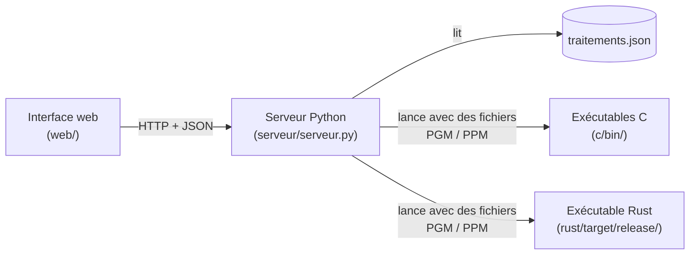

# Traitement d'image

Implémentation des opérations de traitement d'image vues en cours (M2-GI), en **C** ou en **Rust**,
avec une **interface web** commune : on charge une image, on choisit un traitement, on voit le résultat.

- Liste des traitements à implémenter : [`liste-fonctionnalites.txt`](liste-fonctionnalites.txt)
- **Vous développez un traitement ?** Lisez les règles dans [`DEVELOPPEMENT.md`](DEVELOPPEMENT.md).

## Ce que fait l'interface

- Import d'images (PNG, JPEG, PGM, PPM…) par bouton ou glisser-déposer
- Liste des traitements par chapitre du cours, avec recherche, et formulaire de paramètres
- Résultat affiché en image, en graphique (histogramme, profil) ou en tableau de valeurs
- Enchaînement des traitements (le résultat devient l'entrée suivante), téléchargement PNG / PGM / PPM
- Inspecteur de pixels, journal des exécutions, thème clair / sombre

---

## Démarrage rapide

### 1. Prérequis

| Outil | Pour quoi | Linux / macOS | Windows |
|---|---|---|---|
| **Python 3.8+** | le serveur (aucune bibliothèque à installer) | souvent déjà installé | [python.org](https://www.python.org/downloads/) — cocher « Add Python to PATH » |
| **Rust** | les traitements écrits en Rust | [rustup.rs](https://rustup.rs) | [rustup.rs](https://rustup.rs) — accepter l'installation des « Build Tools » de Visual Studio proposée |
| **gcc** | les traitements écrits en C | paquet `gcc` / Xcode | [MSYS2](https://www.msys2.org) (MinGW-w64) |
| un navigateur récent | l'interface | | |

### 2. Compiler les traitements

```bash
# Rust (depuis la racine du dépôt)
cd rust
cargo build --release
cd ..
```

Les traitements C se compilent selon les indications de [`DEVELOPPEMENT.md`](DEVELOPPEMENT.md#ajouter-un-traitement).
Un traitement non compilé apparaît dans l'interface avec la mention « non compilé ».

### 3. Lancer le serveur

Depuis la racine du dépôt :

| Linux / macOS | Windows (PowerShell ou invite de commandes) |
|---|---|
| `python3 serveur/serveur.py` | `py serveur\serveur.py` |

Puis ouvrir **http://127.0.0.1:8000/** dans le navigateur. Laisser le terminal ouvert pendant l'utilisation (`Ctrl + C` pour arrêter).

> ⚠️ Ouvrir directement `web/index.html` (double-clic) **ne fonctionne pas** : la page doit être servie par le serveur.

Options du serveur :

| Option | Défaut | Rôle |
|---|---|---|
| `--port` | `8000` | port d'écoute |
| `--hote` | `127.0.0.1` | adresse d'écoute (local uniquement par défaut) |
| `--registre` | `traitements.json` | fichier décrivant les traitements |
| `--dossier-temp` | dossier temporaire du système | où créer les fichiers échangés avec les traitements |
| `--garder-temp` | | conserver ces fichiers (pour déboguer, voir [`DEVELOPPEMENT.md`](DEVELOPPEMENT.md#le-dossier-de-travail-fichiers-temporaires)) |
| `-v` | | journal détaillé (chaque requête HTTP) |

---

## Architecture en bref



| Composant | Rôle |
|---|---|
| **Interface web** | charger et afficher les images, choisir le traitement et ses paramètres |
| **Serveur** | lire le registre, vérifier la demande, lancer le bon exécutable, renvoyer le résultat |
| **Exécutables C / Rust** | **tout le traitement d'image**, c'est la partie du TP |

Le serveur et l'interface ne font aucun calcul d'image. Pour brancher un nouveau traitement, il suffit de compiler son exécutable et de le déclarer dans `traitements.json`. Le détail est dans [`DEVELOPPEMENT.md`](DEVELOPPEMENT.md).

---

## Organisation du dépôt

```
.
├── README.md                  ce document
├── DEVELOPPEMENT.md           règles à suivre pour développer
├── liste-fonctionnalites.txt  liste des traitements à implémenter
├── traitements.json           registre des traitements
├── serveur/serveur.py         serveur Python
├── web/                       interface (HTML / CSS / JS)
├── rust/                      traitements en Rust (un exécutable, une sous-commande par traitement)
├── c/                         traitements en C
└── images/                    images de test partagées (PGM / PPM)
```

## Répartition du travail

Le groupe compte 6 membres. Chaque lot est **indépendant** : il ne dépend du code d'aucun autre lot,
ce qui permet de travailler tous en même temps. Si un lot a besoin d'une opération d'un autre lot
(convolution, soustraction, seuillage…), il la réécrit dans son propre code.

| Membre | Lot | Contenu (voir [`liste-fonctionnalites.txt`](liste-fonctionnalites.txt)) |
|--------|-----|---------|
| Ruhtra | Bases et contraste | Introduction (canaux, gris, profil, quantification), statistiques et histogramme, amélioration du contraste (LUT, gamma, égalisation), opérations sur une ou deux images |
| Naomi | Filtrage spatial | Changement d'échelle (interpolation), convolution (bords, normalisation), filtres passe-bas, passe-haut, médian, min, max, bruit poivre et sel |
| Evrad | Fourier | FFT 2D et inverse, réel / imaginaire / module / phase, spectre recentré, filtrage spectral (passe-bas, passe-haut, coupe-bande, rehaussement) |
| Cinthia | Contours | Dérivées, Roberts, Prewitt, Sobel, gradient (norme, direction, seuillage), laplacien, Hough, amincissement, seuillage par hystérésis, fermeture des contours |
| Léandre | Segmentation | Seuillage simple et multiple, Otsu, seuillage local adaptatif, k-moyennes, division-fusion, croissance de régions |
| Cabrelle | Binaire et morphologie | Connexité, distances D4 / D8, codage de Freeman, étiquetage des composantes et des contours, érosion, dilatation, ouverture, fermeture, gradients morphologiques |

| Bloc | Responsable | Langage | État |
|------|-------------|---------|------|
| Serveur | Ruhtra | Python | fait |
| Interface web | Ruhtra | HTML/CSS/JS | fait |
| Entrées / sorties PGM-PPM | Ruhtra | Rust | fait (`rust/src/pnm.rs`) |
| Introduction (canaux, gris, profil, quantification) | Ruhtra | | |
| Statistiques et histogramme | Ruhtra | Rust | en cours |
| Amélioration du contraste | Ruhtra | Rust | en cours (égalisation) |
| Opérations sur images | Ruhtra | | |
| Interpolation | Naomi | | |
| Convolution et filtrage spatial | Naomi | | |
| Fourier et filtrage spectral | Evrad | | |
| Détection de contours | Cinthia| | |
| Segmentation | Léandre | Rust | fait |
| Images binaires | Cabrelle | | |
| Morphologie mathématique | Cabrelle| | |

Chacun remplace « Membre n » par son nom et indique son langage en commençant.

---

## Dépannage

| Symptôme | Cause et solution |
|---|---|
| La page reste sur « Connexion… » ou affiche « Ouvert sans serveur » | La page a été ouverte directement. Lancer le serveur et ouvrir l'adresse indiquée ci-dessus. |
| « Serveur injoignable » | Le serveur a été arrêté : le relancer, puis recharger la page. |
| Un traitement est marqué « non compilé » | Compiler le code (étape 2), puis cliquer sur ⟳ dans l'interface. |
| `python3` introuvable sous Windows | Utiliser `py` (ou `python`). |
| `Address already in use` au lancement | Le port 8000 est occupé : `--port 8080`, puis ouvrir http://127.0.0.1:8080/ |
| Un traitement échoue | Le message d'erreur du programme s'affiche dans le résultat et dans le **Journal** en bas de page. |
